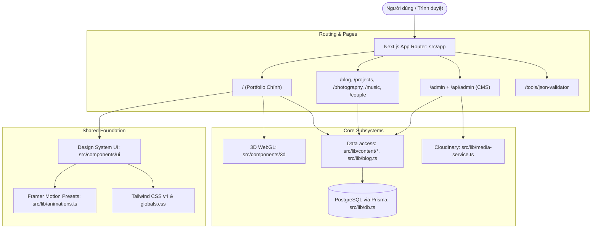
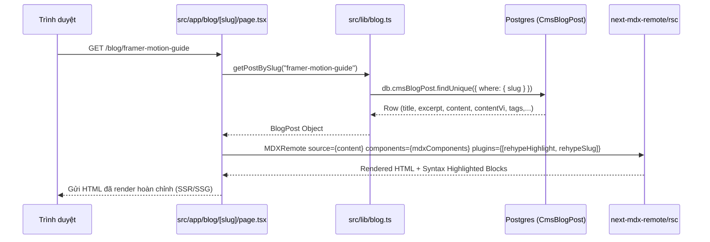

# 🏛️ Kiến Trúc Hệ Thống (Architecture Documentation)

Tài liệu này mô tả chi tiết kiến trúc kỹ thuật, luồng dữ liệu, các phân hệ (subsystems) và nguyên tắc thiết kế của dự án Portfolio.

---

## 1. Tổng Quan Kiến Trúc (Architecture Overview)

Dự án được xây dựng dựa trên **Next.js 14 App Router** với ngôn ngữ **TypeScript** ở chế độ `strict: true`.



---

## 2. Cấu Trúc Thư Mục (Directory Structure)

Chỉ liệt kê thư mục và file chính:

```
portfolio/
├── content/                   # Dữ liệu cũ (blog/*.mdx, data/*.json) — chỉ là nguồn cho scripts/migrate-json-to-db.ts
├── docs/                      # ARCHITECTURE, FEATURES, CUSTOMIZATION_GUIDE, DEPLOYMENT
├── prisma/schema.prisma       # Schema Postgres (model Cms*, Track/Playlist,...)
├── public/                    # Static assets (fonts/,...)
├── scripts/
│   └── migrate-json-to-db.ts  # Migrate 1 lần content/ → Postgres
├── src/
│   ├── app/                   # Next.js App Router
│   │   ├── page.tsx           # Trang chủ (Hero → About → Skills → Projects → PhotoPreview → BlogPreview → Contact)
│   │   ├── layout.tsx         # Root layout (Theme/Language/Music providers, GlobalBackground, Navigation, Footer, GlobalMusicPlayer, THEME_INIT_SCRIPT)
│   │   ├── not-found.tsx      # 404 (nền hố đen)
│   │   ├── globals.css        # Tailwind v4, theme tokens (dark + light), utilities
│   │   ├── admin/             # CMS: blog, couple, media, music, nav-links, photography, projects, site-config, skills, social-links, login
│   │   ├── api/               # admin/**, contact, couple, music/{tracks,upload}
│   │   └── blog/, projects/, photography/ (+ album/[slug]), music/, couple/, tools/json-validator/
│   ├── components/
│   │   ├── 3d/                # SceneContainer, StarryBackground3D, blackhole/ (BlackHoleCanvas + engine)
│   │   ├── admin/, blog/, music/, photography/, projects/, sections/, tools/, layout/ (GlobalBackground)
│   │   └── ui/                # Button, GlassCard, TiltCard, AnimatedSection, Navigation, Footer, Skeleton, ImageWithSkeleton, ThemeToggle, LanguageSwitcher, Icon,...
│   ├── context/               # LanguageContext, MusicContext, ThemeContext, ToastContext
│   ├── generated/prisma/      # Prisma client (sinh bởi prisma generate, gitignored)
│   ├── lib/
│   │   ├── db.ts              # Prisma singleton (pg Pool + @prisma/adapter-pg)
│   │   ├── content/*.ts       # Đọc/ghi từng loại nội dung (unstable_cache cho đọc public)
│   │   ├── blog.ts, admin-auth.ts, session-token.ts, cloudinary.ts, media-service.ts, rate-limit.ts, seo.ts
│   │   ├── constants.ts       # EXCLUDED_ROUTE_PREFIXES (route luôn dark)
│   │   └── animations.ts, types.ts, utils.ts, content-overrides.ts, section-defaults.ts
│   ├── locales/               # en.ts, vi.ts
│   └── middleware.ts          # Chặn /admin khi chưa đăng nhập
├── CLAUDE.md, README.md
├── eslint.config.mjs, next.config.js, prisma.config.ts, tsconfig.json, package.json
└── .env.example               # Danh sách biến môi trường
```

---

## 3. Các Phân Hệ Chính (Core Subsystems)

### 3.1. 3D WebGL Pipeline (`src/components/3d`)

Phân hệ 3D được xây dựng dựa trên `@react-three/fiber` (R3F), `@react-three/drei` và `three`:

1. **`SceneContainer.tsx` (Wrapper Chuẩn)**:
   - Quản lý khởi tạo `<Canvas>` của Three.js với cấu hình camera tối ưu.
   - **Tự động nhận diện `prefers-reduced-motion`**: Nếu người dùng bật chế độ giảm chuyển động trong hệ điều hành, hệ thống sẽ render Fallback CSS gradient thay vì khởi động WebGL context để tiết kiệm GPU và bảo vệ trải nghiệm người dùng.
   - **`SceneErrorBoundary`**: Bọc toàn bộ 3D scene trong một Error Boundary cấp component. Khi WebGL bị crash hoặc driver GPU không hỗ trợ, màn hình sẽ fallback an toàn mà không làm sập toàn bộ trang web.
   - Dùng cho `StarryBackground3D` (nền sao toàn site qua `GlobalBackground`). `ParticleField` đã bị xoá trong đợt overhaul 11/2026; nền Contact là CSS shooting stars (`.portfolio-contact-stars`, dừng bằng IntersectionObserver).

2. **Hố đen trang chủ (`sections/HomeBlackHole.tsx` → `blackhole/BlackHoleCanvas.tsx`)** — ngoại lệ không đi qua `SceneContainer`:
   - Engine raymarching Schwarzschild tự quản lý `THREE.WebGLRenderer` + vòng lặp riêng (không phải R3F), tự co giãn theo phần tử cha (`ResizeObserver`).
   - `HomeBlackHole` là lớp `fixed` toàn trang trên `/` ("companion" phía sau mọi section): import động `ssr: false`, `deferStart`, `scrollScope="page"`; khi `prefers-reduced-motion` hoặc WebGL không dùng được thì không mount canvas mà để nền tĩnh. Camera đổi theo cuộn qua `requestAnimationFrame`, không qua React state. Trang 404 dùng cùng engine.
   - Vì hố đen nằm sau toàn trang, các section không phủ nền Void đặc full-width: `#portfolio-sections` chỉ có veil nhẹ + scrim mềm sau tiêu đề, khối nội dung dày dùng bề mặt Hull đặc (`.portfolio-solid`).

---

### 3.2. MDX Blog Engine (`src/lib/blog.ts`, bảng `CmsBlogPost`)

Hệ thống blog hoạt động theo mô hình Server-Side MDX Compilation:



- **Static Generation (`generateStaticParams`)**: Sinh static HTML lúc build cho mọi slug có trong DB; bài được tạo/sửa ở `/admin/blog` (admin API gọi `revalidateTag("blog")`).
- **Dynamic SEO (`generateMetadata`)**: Tiêu đề, mô tả và OpenGraph lấy từ dữ liệu bài viết.
- `content/blog/*.mdx` chỉ còn là nguồn cho `scripts/migrate-json-to-db.ts`.
- **Custom MDX Components**: Ghi đè toàn bộ các thẻ HTML cơ bản (`h1`-`h3`, `p`, `a`, `pre`, `code`, `blockquote`) bằng giao diện glassmorphic tối đồng bộ với theme của ứng dụng.

---

### 3.3. JSON Parameter Validator (`src/components/tools/JsonValidator.tsx`)

Công cụ kiểm tra tính toàn vẹn dữ liệu JSON:

- **Matching Theo Quy Ước Suffix**: Tự động ghép cặp các file `tb_def_exception_parameter_<suffix>.json` và `tb_def_parameter_<suffix>.json`.
- **Client-Side File Processing**: Đọc và parse dữ liệu hoàn toàn trên trình duyệt thông qua `FileReader` API, đảm bảo an toàn dữ liệu và tốc độ xử lý tức thì cho file dung lượng lớn.
- **Xác Thực Khóa**: Kiểm tra danh sách `tb_def_parameter__id` trong file exception có tồn tại tương ứng trong file parameter hay không, thống kê chi tiết các ID bị thiếu và hỗ trợ xuất báo cáo JSON.

---

### 3.4. Hệ Thống Design System & Animation (`src/app/globals.css`, `src/lib/animations.ts`)

- **Tailwind CSS v4**: Cấu hình theme trực tiếp qua `@theme inline`. Có hai lớp token:
  - **Public (scoped)** — khối `.portfolio-theme` (bọc các trang công khai) định nghĩa `--portfolio-void` `#05070D`, `--portfolio-hull` `#0C1018`, `--portfolio-ink` `#ECE9E4`, `--portfolio-dust` `#9BA1AC`, `--portfolio-accretion` `#F2B45A` (+ `-hover`, `--portfolio-on-accretion`), `--portfolio-hairline`, `--portfolio-control`; bản light (`[data-theme="light"] .portfolio-theme`) đổi sang Void `#F5F6F8`, Hull `#FFFFFF`, Ink `#10131A`, Dust `#4F5562`, Accretion `#9A5B0B`. Utility tương ứng: `bg-portfolio-hull`, `text-portfolio-ink`, `text-portfolio-accretion`… Font public: Be Vietnam Pro (fallback Inter).
  - **Legacy** (`--background: #050505`, `--foreground`, `--purple-500`, `--cyan-500`, `.glass`, `.gradient-text`…) — vẫn dùng cho `/admin`, `/couple`, `/music`, lightbox và các trang chưa chuyển; không xoá.
- **Class bố cục trang chủ** (`globals.css`): `.portfolio-section`, `.portfolio-column` (≤1120px, gutter 16px), `.portfolio-solid` (bề mặt Hull, radius 8px), `.portfolio-case` (thẻ dự án, glow theo `--lens-x/--lens-y`), `.portfolio-constellation*`, `.portfolio-photo-strip`, `.portfolio-input`, `.portfolio-signal-ring`, `.portfolio-copy-ring`, `.portfolio-action*` (nút), `.portfolio-text-link`.
- **Motion** (`src/lib/animations.ts`): mỗi section một khoảnh khắc chuyển động, `viewport={{ once: true }}`, reduced-motion = trạng thái cuối:
  - Hero: typewriter + `orbitIn`/`clipReveal`; `SectionHeading`: star-ignition + accent line.
  - About `factsStagger`/`factsOrbit`; Skills `constellationDraw` (vẽ đường một lần, layout tất định từ `src/lib/constellation-layout.ts`); Projects lensing khi hover/focus (CSS variables qua ref); Photo strip parallax 8–24px (một rAF, dừng ngoài viewport); Blog `shootingStarRow`; Contact signal rings khi gửi + vòng nhỏ khi copy email.
  - Giá trị tần suất cao (pointer, scroll) ghi vào ref/CSS variable, không setState mỗi frame. Ngoài hố đen, tối đa một vòng lặp liên tục trong viewport.
  - `fadeInUp`, `staggerContainer`, `blurFadeIn`… vẫn còn cho các trang chưa chuyển; `TiltCard`/`GlassCard` không còn dùng trên trang chủ.

---

### 3.5. Hệ Thống Chế Độ Sáng/Tối (`src/context/ThemeContext.tsx`, `src/components/ui/ThemeToggle.tsx`)

Giao diện gốc của site là **Dark** (không đổi); Light mode được thêm vào dưới dạng lớp phủ **cộng thêm**, không phải đảo ngược từng class:

- **Biến thể Tailwind tuỳ biến**: `globals.css` khai báo `@custom-variant light (&:where([data-theme="light"], [data-theme="light"] *));` — mọi class tiền tố `light:` chỉ có hiệu lực khi `<html>` (hoặc tổ tiên gần nhất) có `data-theme="light"`. Component chỉ cần **thêm** class `light:` bên cạnh class dark gốc, không xoá/thay class cũ.
- **`ThemeProvider`** (bọc toàn app ở `layout.tsx`, bên trong `<script>` chống nháy theme): phát hiện theme ưu tiên qua `localStorage["portfolio_theme"]`, fallback `prefers-color-scheme`; tiếp tục lắng nghe sự kiện đổi theme OS nếu người dùng chưa từng chọn thủ công. Ghi `data-theme` lên `document.documentElement` mỗi khi theme đổi.
- **Chống FOUC (Flash of Unstyled/Incorrect Content)**: một inline script chặn render trong `layout.tsx` (`THEME_INIT_SCRIPT`) chạy **trước khi React hydrate**, set sẵn `data-theme` bằng đúng logic của `ThemeContext.tsx` — 2 nơi này bắt buộc đồng bộ.
- **Route ngoại lệ luôn Dark**: `EXCLUDED_ROUTE_PREFIXES` (`src/lib/constants.ts`) = `/admin`, `/couple`, `/music` — `resolvedTheme` bị ép về `"dark"` bất kể lựa chọn người dùng khi đang ở các route này.
- **Ngoại lệ theo component**: modal `PhotoLightboxModal.tsx` trong module Photography chủ đích luôn Dark ("theater mode"), độc lập với theme hiện tại của trang.
- Design tokens theo theme (`--background`, `--foreground`, `--glass-bg`, `--glow-purple-color`, `--glow-cyan-color`, `--scrollbar-*`, `--selection-*`) được định nghĩa lại trong khối `[data-theme="light"]` — các utility Tailwind theo token (`bg-background`, `text-foreground`) tự đổi màu mà **không** cần tiền tố `light:`. Token `--portfolio-*` (mục 3.4) cũng tự đổi theo theme, nên component trang chủ dùng token thay cho cặp class `text-white`/`light:text-neutral-900`.
- Kiểm chứng 11/2026 (Task 20): mọi chữ trên trang chủ đạt ≥4.5:1 so với nền CSS đã composite (dark thấp nhất 7.33:1, light 5.14:1), viền input ≥7:1. Phép đo không tính pixel của canvas hố đen phía sau; vùng chữ dày luôn nằm trên bề mặt Hull đặc hoặc scrim.

---

### 3.6. Điều Hướng & Cuộn Trang (`src/components/ui/Navigation.tsx`)

- **Breakpoint**: menu ngang (desktop) chuyển sang nút menu (mobile) tại `lg` (**1024px**). Mục có `children` (vd. "Hobby") là nút dropdown, không phải link; `href` của mục cha không được dùng (để `#`). Footer trải phẳng các mục con thay cho mục cha.
- **Cuộn tới section**: link `#section` dùng anchor gốc của trình duyệt; khoảng trống dưới thanh nav fixed lấy từ `scroll-padding-top` trên `html` (`globals.css`). Các section trang chủ dùng `.portfolio-section` (`padding: 2rem 0 6rem`), không cần spacer hay dời `pb-*` như trước.
- **Section đang xem**: một listener scroll/resize gom qua `requestAnimationFrame`, chỉ `setState` khi section thay đổi (`getActiveSection`), không render lại mỗi frame.
- **Ẩn Blog khi trống**: `layout.tsx` gọi `filterBlogNavLinks(navLinks, hasPosts)` (`src/lib/navigation-section.ts`) nên nav và footer bỏ link `/blog`, `#blog` khi không còn bài; `BlogPreviewSection` trả về `null`.

---

### 3.7. Lớp Dữ Liệu (Prisma + PostgreSQL)

- `src/lib/db.ts`: Prisma client (sinh ở `src/generated/prisma`) với driver adapter `@prisma/adapter-pg`, singleton qua `globalThis`. `prisma.config.ts` đọc `DATABASE_URL`.
- Mọi nội dung (site config, nav/social links, skills, projects, ảnh/album, couple, media registry, blog, tin nhắn liên hệ) nằm ở các model `Cms*`, truy cập qua `src/lib/content/*.ts` và `src/lib/blog.ts`; Music dùng `Track`/`Playlist`/`PlaylistTrack`.
- Đọc public được cache bằng `unstable_cache`; route `/api/admin/**` kiểm tra `requireAdminSession()` rồi ghi DB và `revalidateTag(...)`.

---

## 4. Quản Lý Trạng Thái & Luồng Dữ Liệu (State Management)

| Thành phần | Cơ chế State | Mục đích |
|---|---|---|
| **Nội dung site** | Postgres (Prisma) qua `src/lib/content/*`, đọc ở Server Component rồi truyền props | Cấu hình site, kỹ năng, dự án, ảnh, liên kết, couple, blog — sửa qua `/admin` |
| **Contact Form** | `react-hook-form` + `zod` | Validation form liên hệ theo schema nghiêm ngặt, quản lý trạng thái submit và hiển thị thông báo |
| **Blog Filter** | React Local State (`useState`) | Lọc danh sách bài viết theo danh mục (category) tức thì tại Client |
| **3D Animations** | `useRef` + Three.js `useFrame` | Truyền tọa độ chuột trực tiếp vào GPU loop, tránh re-render React DOM |
| **JSON Validator** | React Local State (`useState`) | Quản lý danh sách file upload, kết quả phân tích và bộ lọc lỗi |
| **Light/Dark Theme** | React Context (`ThemeContext`) + `localStorage` + `data-theme` attribute | Đồng bộ theme giữa inline blocking script, Context và CSS (`light:` variant), loại trừ theo route (`EXCLUDED_ROUTE_PREFIXES`) |

---

## 5. Tiêu Chuẩn Hiệu Năng & SEO (Performance & SEO)

1. **Tối Ưu Font**: Sử dụng `next/font/google` nạp `Inter` và `Space Grotesk` với cơ chế zero layout shift (font display swap).
2. **Dynamic Imports**: Các component nặng (WebGL, các section dưới màn hình đầu) được tải bằng `next/dynamic` (WebGL dùng `ssr: false`).
3. **Semantic HTML & Metadata**:
   - Thẻ `<h1>` duy nhất trên trang chủ, phân cấp `<h2>`-`<h4>` rõ ràng.
   - Hỗ trợ đầy đủ OpenGraph và Twitter Card metadata trên toàn bộ các route.
   - Thẻ `<html className="scroll-smooth">` hỗ trợ cuộn mượt mà giữa các section.
